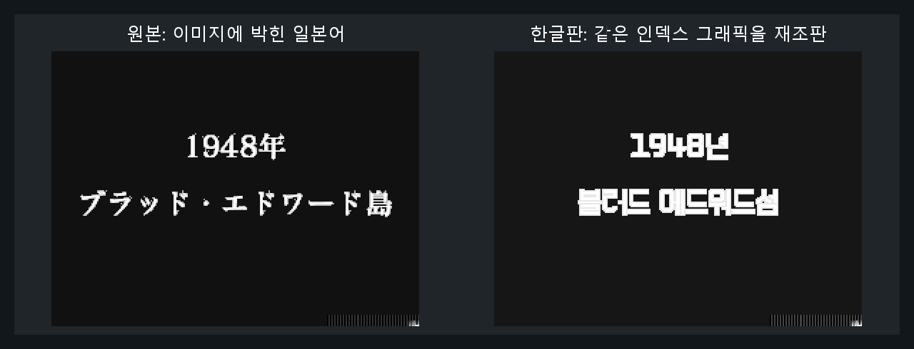

# 어나더 코드: 두 개의 기억 — 닌텐도 DS

닌텐도 DS **어나더 코드: 두 개의 기억** 한글 번역 패치 프로젝트입니다. 애슐리가 섬의 비밀과 가족의 기억을 추적하는 어드벤처 게임입니다.

> **최종 배포본 · 2026-08-29**

<!-- game-preview:start -->

  

**오프닝 한글 그래픽 비교** — 공개 작업기 내 오프닝 그래픽 비교. 실제 게임 캡처가 아닌 비교 자료입니다.
<!-- game-preview:end -->

## 다운로드 및 적용 방법

1. 아래 체크섬 또는 상세 안내와 일치하는 원본을 준비합니다.
2. [최종 배포 패치 다운로드](https://github.com/akuma815/nds-another-code-kr-patch/releases/tag/final-20260829)에서 ZIP을 받아 모두 압축 해제합니다.
3. 원본 ROM 또는 ISO를 동봉 `apply.cmd`에 끌어다 놓습니다.
4. 생성된 한글판 파일의 SHA-256을 확인하고 실행합니다.

## 주의사항

- 일본판 ANOJ 전용입니다.
- 패치 적용·정적 검증 기록이 있으며, 최종 수정본의 전 구간 실플레이 검수는 미완료입니다.
- 원본 게임·BIOS 및 패치가 적용된 게임 이미지는 포함하지 않습니다.

## 체크섬

| 구분 | SHA-256 |
| --- | --- |
| 원본 | `6c8cb19de7b86dc5f1147e4927d6916571968a06b5c2e9b88f62c22c271dd0a1` |
| 패치 파일 `AnotherCode_KR_Final_20260829.xdelta` | `188aafcc8c179cacbb489d566a7732b3ca661a6570a701f25f6661ee6e4edf53` |
| 패치 후 이미지 | `28b914e99a54b74576f0684a49898c89989ee92d2566d6683e6c1246b9711e9d` |
| 배포 압축 파일 | `a73f24e2954af52e7f51bc5100f837bdf8d8072bbb6166420d23d7335cf2f1ae` |

## 소스 및 작업 기록

[공개 소스 구성과 빌드 전제](docs/SOURCE_GUIDE.md) · [상세 패치 안내](docs/PATCH_GUIDE.txt)
